<!--
  This file is generated. Edit src/content.ts, then run: bun install && bun run build
  The images in assets/ are drawn by src/build.ts in the OXIDE PRESS design system, like my site.
-->

<a href="https://mounir-ghafir.mounir-ghafir-officiel.workers.dev/"><picture><source media="(prefers-color-scheme: dark)" srcset="assets/hero-night.svg"><source media="(prefers-color-scheme: light)" srcset="assets/hero-day.svg">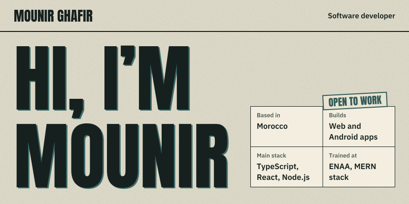</picture></a>

I’m a software developer from Morocco. I like building useful apps that solve real problems, and I care about clean code that stays easy to change.

<a href="https://mounir-ghafir.mounir-ghafir-officiel.workers.dev/#work"><picture><source media="(prefers-color-scheme: dark)" srcset="assets/btn-work-night.svg"><source media="(prefers-color-scheme: light)" srcset="assets/btn-work-day.svg">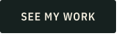</picture></a>
<a href="mailto:mounir.ghafir.officiel@gmail.com"><picture><source media="(prefers-color-scheme: dark)" srcset="assets/btn-email-night.svg"><source media="(prefers-color-scheme: light)" srcset="assets/btn-email-day.svg">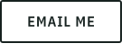</picture></a>
<a href="https://mounir-ghafir.mounir-ghafir-officiel.workers.dev/Mounir_Ghafir_Resume.pdf"><picture><source media="(prefers-color-scheme: dark)" srcset="assets/btn-resume-night.svg"><source media="(prefers-color-scheme: light)" srcset="assets/btn-resume-day.svg"></picture></a>

<h3><picture><source media="(prefers-color-scheme: dark)" srcset="assets/head-work-night.svg"><source media="(prefers-color-scheme: light)" srcset="assets/head-work-day.svg">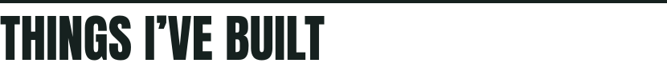</picture></h3>

Two complete projects, each built on my own from the first screen to the tests.

<a href="https://mounir-ghafir.mounir-ghafir-officiel.workers.dev/#/work/devconnect"><picture><source media="(prefers-color-scheme: dark)" srcset="assets/devconnect-cover-night.webp"><source media="(prefers-color-scheme: light)" srcset="assets/devconnect-cover-day.webp">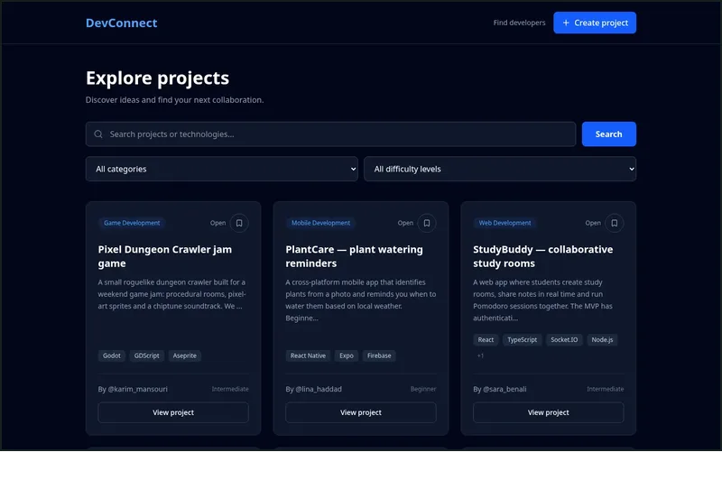</picture></a>&ensp;&emsp;
<a href="https://mounir-ghafir.mounir-ghafir-officiel.workers.dev/#/work/devconnect"><picture><source media="(prefers-color-scheme: dark)" srcset="assets/devconnect-night.svg"><source media="(prefers-color-scheme: light)" srcset="assets/devconnect-day.svg">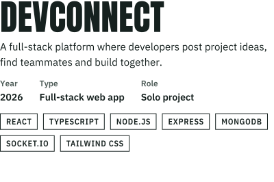</picture></a>

18 pages, more than 40 API endpoints and more than 90 integration tests. [Read the case study](https://mounir-ghafir.mounir-ghafir-officiel.workers.dev/#/work/devconnect) or [browse the source](https://github.com/freedev-lab/DevConnect).

<a href="https://mounir-ghafir.mounir-ghafir-officiel.workers.dev/#/work/linkify"><picture><source media="(prefers-color-scheme: dark)" srcset="assets/linkify-cover-night.svg"><source media="(prefers-color-scheme: light)" srcset="assets/linkify-cover-day.svg">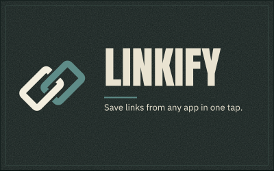</picture></a>&ensp;&emsp;
<a href="https://mounir-ghafir.mounir-ghafir-officiel.workers.dev/#/work/linkify"><picture><source media="(prefers-color-scheme: dark)" srcset="assets/linkify-night.svg"><source media="(prefers-color-scheme: light)" srcset="assets/linkify-day.svg">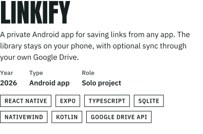</picture></a>

English and Arabic interfaces, no servers and 82 unit tests. In testing before its Google Play release. [Read the case study](https://mounir-ghafir.mounir-ghafir-officiel.workers.dev/#/work/linkify) or [visit the app’s page](https://linkify-privacy.pages.dev/home/).

<h3><picture><source media="(prefers-color-scheme: dark)" srcset="assets/head-about-night.svg"><source media="(prefers-color-scheme: light)" srcset="assets/head-about-day.svg">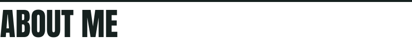</picture></h3>

I earned a specialized technician diploma in full-stack web development at ISTA in Oued Zem, then completed the MERN stack program at Ahmed Hansali Digital School (ENAA) in Beni Mellal.

I’m looking for my first developer job. Until then, I learn by building complete projects, from the first screen to the tests. I use AI tools to work faster and try more ideas, and I still care most about code that is clean, readable and easy to maintain.

<picture><source media="(prefers-color-scheme: dark)" srcset="assets/education-night.svg"><source media="(prefers-color-scheme: light)" srcset="assets/education-day.svg">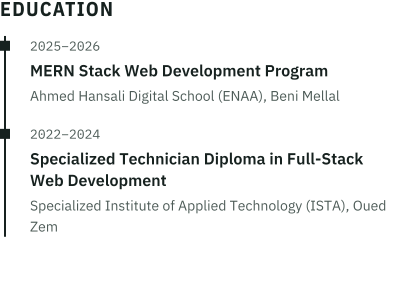</picture>&ensp;&emsp;
<picture><source media="(prefers-color-scheme: dark)" srcset="assets/now-night.svg"><source media="(prefers-color-scheme: light)" srcset="assets/now-day.svg">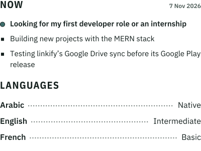</picture>

<h3><picture><source media="(prefers-color-scheme: dark)" srcset="assets/head-tools-night.svg"><source media="(prefers-color-scheme: light)" srcset="assets/head-tools-day.svg">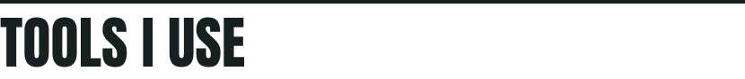</picture></h3>

<picture><source media="(prefers-color-scheme: dark)" srcset="assets/tools-1-night.svg"><source media="(prefers-color-scheme: light)" srcset="assets/tools-1-day.svg">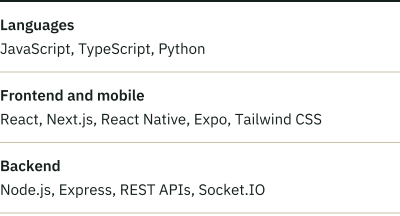</picture>&ensp;&emsp;
<picture><source media="(prefers-color-scheme: dark)" srcset="assets/tools-2-night.svg"><source media="(prefers-color-scheme: light)" srcset="assets/tools-2-day.svg">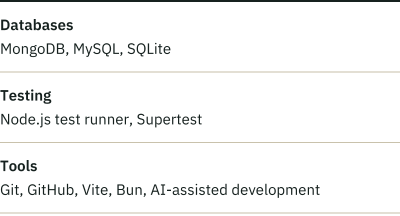</picture>

<h3><picture><source media="(prefers-color-scheme: dark)" srcset="assets/contact-night.svg"><source media="(prefers-color-scheme: light)" srcset="assets/contact-day.svg">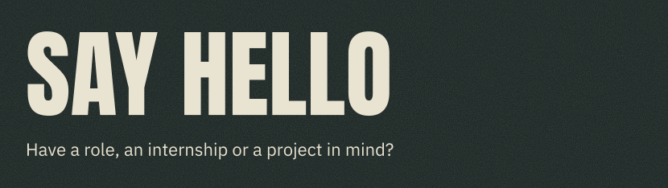</picture></h3>

Send me an email at **[mounir.ghafir.officiel@gmail.com](mailto:mounir.ghafir.officiel@gmail.com)**.

<a href="mailto:mounir.ghafir.officiel@gmail.com"><picture><source media="(prefers-color-scheme: dark)" srcset="assets/btn-email-night.svg"><source media="(prefers-color-scheme: light)" srcset="assets/btn-email-day.svg"></picture></a>
<a href="https://www.linkedin.com/in/mounir-ghafir-b4b737447/"><picture><source media="(prefers-color-scheme: dark)" srcset="assets/btn-linkedin-night.svg"><source media="(prefers-color-scheme: light)" srcset="assets/btn-linkedin-day.svg">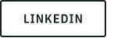</picture></a>
<a href="https://mounir-ghafir.mounir-ghafir-officiel.workers.dev/"><picture><source media="(prefers-color-scheme: dark)" srcset="assets/btn-site-night.svg"><source media="(prefers-color-scheme: light)" srcset="assets/btn-site-day.svg"></picture></a>
<a href="https://mounir-ghafir.mounir-ghafir-officiel.workers.dev/Mounir_Ghafir_Resume.pdf"><picture><source media="(prefers-color-scheme: dark)" srcset="assets/btn-resume-night.svg"><source media="(prefers-color-scheme: light)" srcset="assets/btn-resume-day.svg"></picture></a>

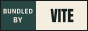

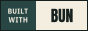
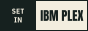
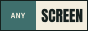
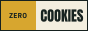
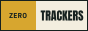

The type is Anton and IBM Plex, drawn as SVG paths so it looks the same on every screen, in GitHub’s light and dark themes. The buttons above come from my site and say what it is made of. Updated 7 Nov 2026.
