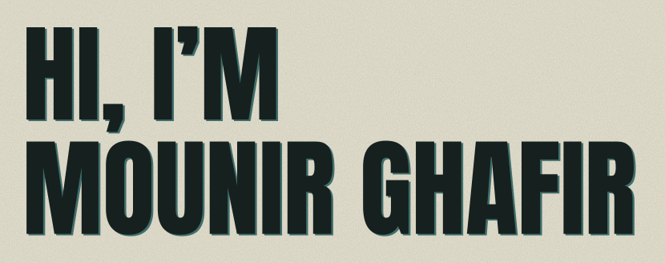
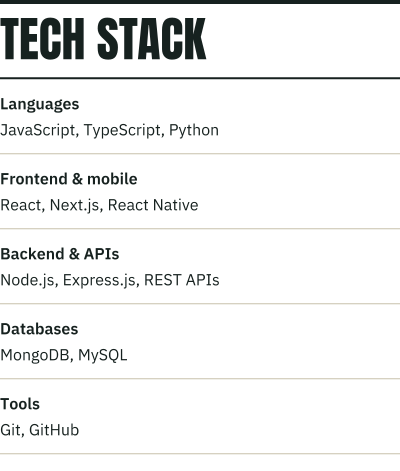
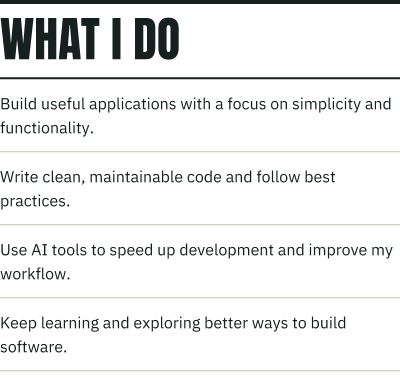
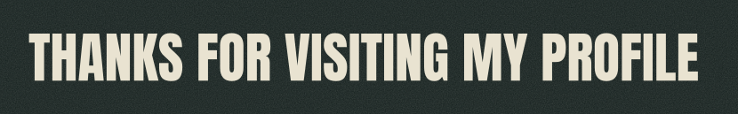

<!--
  This file is generated. Edit src/content.ts, then run: bun install && bun run build
  The images in assets/ are drawn by src/build.ts in the OXIDE PRESS design system, like my site.
-->

<picture><source media="(prefers-color-scheme: dark)" srcset="assets/greeting-night.svg"><source media="(prefers-color-scheme: light)" srcset="assets/greeting-day.svg"></picture>

I’m a software developer from Morocco who enjoys building useful applications that solve real problems.

I care about writing clean, maintainable code, following software development best practices, and using AI tools to work more efficiently and build better solutions.

<picture><source media="(prefers-color-scheme: dark)" srcset="assets/stack-night.svg"><source media="(prefers-color-scheme: light)" srcset="assets/stack-day.svg"></picture>&ensp;&emsp;
<picture><source media="(prefers-color-scheme: dark)" srcset="assets/what-i-do-night.svg"><source media="(prefers-color-scheme: light)" srcset="assets/what-i-do-day.svg"></picture>

<picture><source media="(prefers-color-scheme: dark)" srcset="assets/thanks-night.svg"><source media="(prefers-color-scheme: light)" srcset="assets/thanks-day.svg"></picture>

